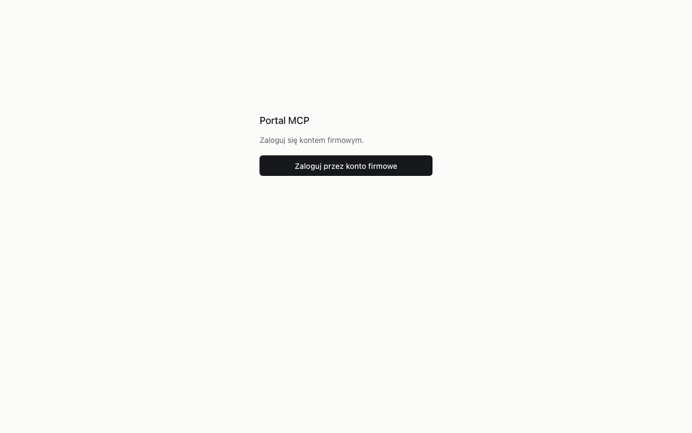
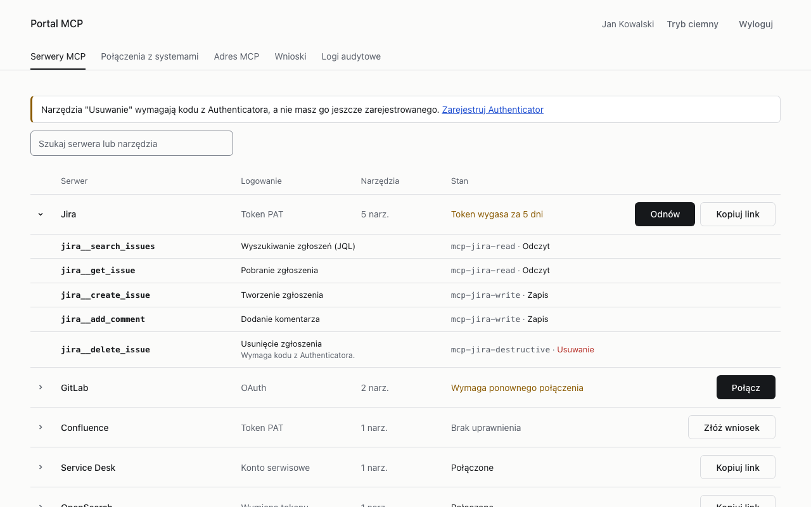
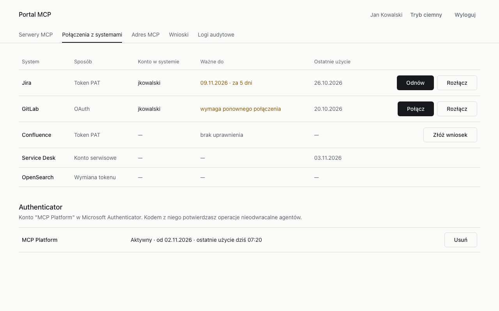
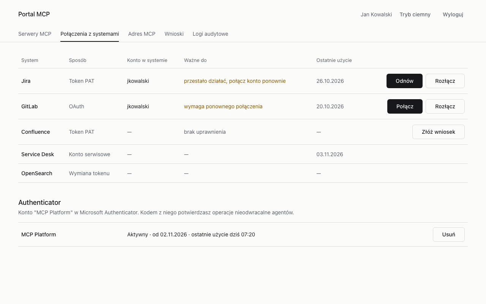
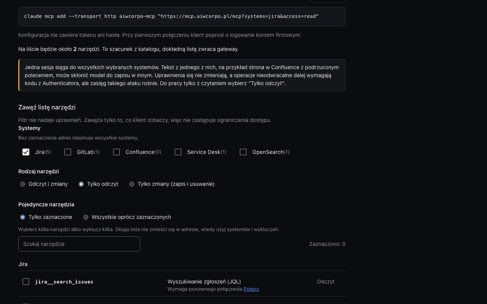
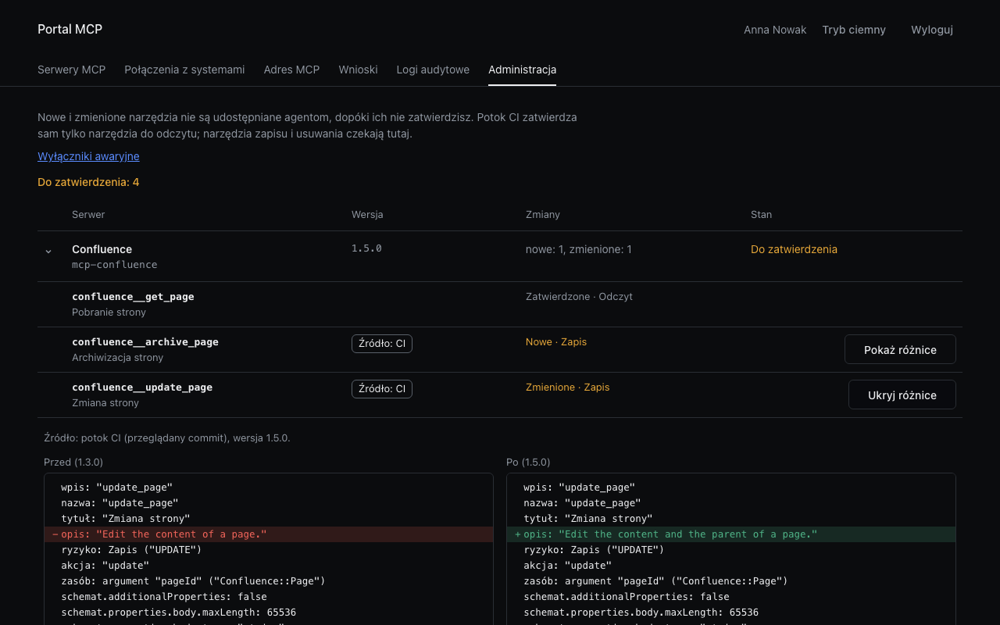
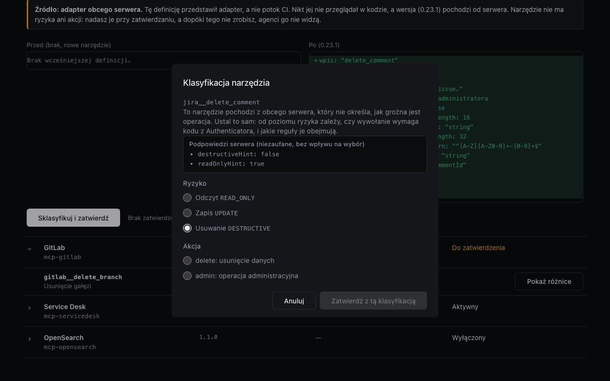
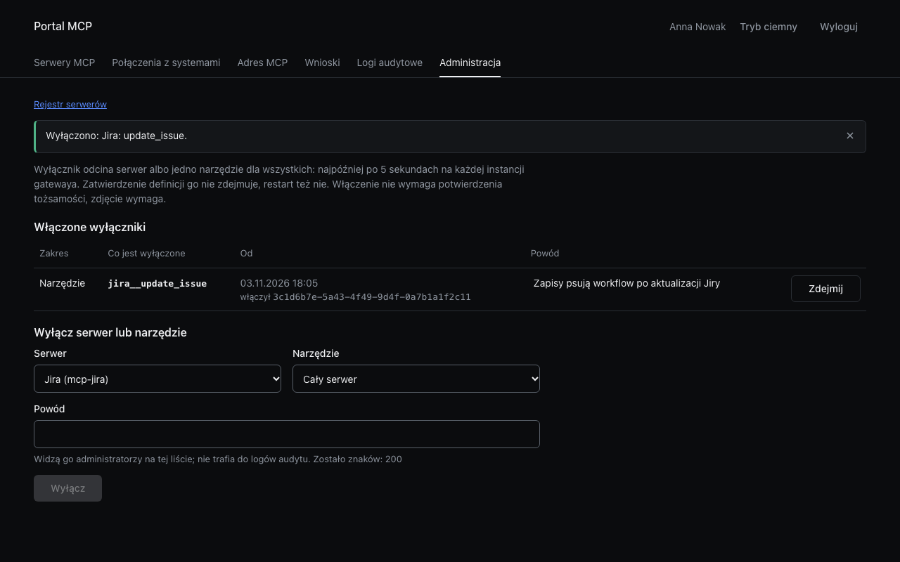
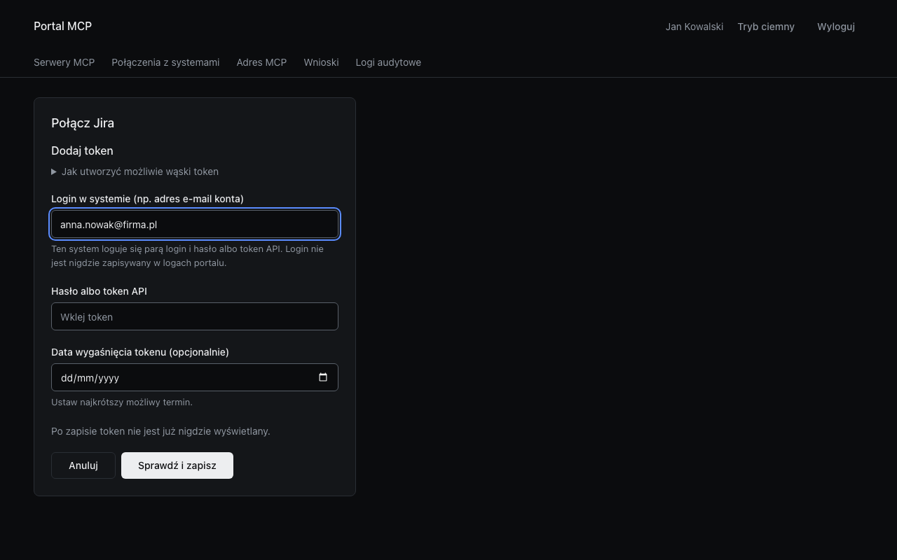

# mcp-portal

Portal platformy MCP: strona, na której użytkownik widzi serwery MCP dostępne dla niego, łączy konta w systemach
(Jira, Confluence, GitLab, Service Desk, OpenSearch), składa wnioski o uprawnienia i składa adres `/mcp` z filtrem, a
administrator zatwierdza definicje narzędzi, klasyfikuje narzędzia obcych serwerów i w razie incydentu wyłącza serwer albo
narzędzie. Dwa komponenty w jednym repozytorium:

| Katalog | Co to | Opis |
| --- | --- | --- |
| `bff/` | backend (Java 25, Spring Boot 4.1): logowanie OIDC, sesja po stronie serwera, API C12, agregacja gateway'a (C5), brokera (C4) i IGA (C13); przeglądarka nie dostaje żadnego tokenu ani sekretu | [bff/README.md](bff/README.md) |
| `web/` | frontend (Angular 22, Angular Material): tylko API C12, bez ręcznie pisanych typów API | [web/README.md](web/README.md) |

Dla kogo: to produkt dla operatorów i użytkowników platformy, wdrażany jako obrazy kontenerów, a nie biblioteka. Instalacja
i codzienna obsługa całej platformy: repozytorium `mcp-docs` (w przygotowaniu); tutaj to, czego potrzeba do postawienia i
utrzymania samego portalu. Kontrakty: `mcp-contracts` 6.3.2. Licencja: Apache-2.0 ([LICENSE](LICENSE), [NOTICE](NOTICE));
zgłaszanie podatności: [SECURITY.md](SECURITY.md); zmiany: [CHANGELOG.md](CHANGELOG.md); praca nad kodem:
[CONTRIBUTING.md](CONTRIBUTING.md).

## Zrzuty ekranu

Zrobione z buildu na mockach MSW (dane z przykładów kontraktu, wymyślony użytkownik, żadnego prawdziwego konta ani tokenu);
odtwarzanie: `cd web && npm run screenshots`.

| | |
| --- | --- |
|  Logowanie przez konto firmowe (OIDC). |  Serwery MCP ze statusem, akcją i narzędziami z poziomem ryzyka. |
|  Połączenia z systemami i Authenticator. |  Połączenie, któremu zniknął sekret: wiersz prosi o ponowne połączenie. |
|  Adres `/mcp` z filtrem i gotowe polecenia dla klientów. |  Administracja: różnice między zatwierdzoną a oczekującą definicją. |
|  Klasyfikacja narzędzia obcego serwera: adapter jest tylko do odczytu, więc dialog oferuje wyłącznie Odczyt i `read`. |  Wyłącznik awaryjny: lista włączonych, włączenie bez MFA, zdjęcie po świeżym MFA. |
|  Token w schemacie Basic (login i hasło albo token): pole loginu obok hasła albo tokenu API; login nie wraca z serwera i nie trafia do logów. | |

## Instalacja

### Z obrazów

Obrazy powstają z `Dockerfile` w korzeniu repozytorium; nazwy i tagi po pierwszym wydaniu: `ghcr.io/aiwcorpo/mcp-portal-bff`,
`ghcr.io/aiwcorpo/mcp-portal-web` i `ghcr.io/aiwcorpo/mcp-portal` (BFF razem z aplikacją), tag `v<wersja>`. Do tego czasu
obrazy buduje się lokalnie (niżej) i mają tag `m6-<sha>`.

| Cel `Dockerfile` | Obraz | Zawartość |
| --- | --- | --- |
| `bff` | `mcp-portal-bff` | BFF, port 8080; aplikację serwuje reverse proxy przed nim |
| `web` | `mcp-portal-web` | nginx ze zbudowaną aplikacją, port 8080, bez stanu, tylko do odczytu |
| `portal` | `mcp-portal` | BFF z aplikacją w środku (`PORTAL_WEB_DIST=/app/web`): jeden kontener, jeden origin |

Portal ma być wystawiony pod jedną domeną razem z gatewayem (`/mcp`, `/s/`) i własnym API (`/api`), więc przed nim stoi
reverse proxy; wzorcowa konfiguracja jest w `mcp-platform-dev` (`proxy/`, `docker-compose.yml`). Najprostszy start to cel
`portal`:

```bash
docker run -d --name mcp-portal -p 8080:8080 \
  -e PORTAL_PUBLIC_BASE_URL=<publiczny adres portalu, https> \
  -e PORTAL_OIDC_ISSUER_URI=<issuer OIDC, ten sam co w tokenach> \
  -e PORTAL_OIDC_CLIENT_ID=mcp-portal-bff \
  -e PORTAL_OIDC_CLIENT_SECRET=<sekret klienta poufnego> \
  -e PORTAL_BROKER_URL=https://<broker>:8443 -e PORTAL_BROKER_TLS_NAME=<nazwa w certyfikacie brokera> \
  -e PORTAL_GATEWAY_ADMIN_URL=https://<gateway>:8443 -e PORTAL_GATEWAY_ADMIN_TLS_NAME=<nazwa w certyfikacie gatewaya> \
  -e PORTAL_TLS_KEYSTORE=/certs/keystore.p12 -e PORTAL_TLS_KEYSTORE_PASSWORD=<hasło> \
  -e PORTAL_TLS_TRUSTSTORE=/certs/truststore.p12 -e PORTAL_TLS_TRUSTSTORE_PASSWORD=<hasło> \
  -e PORTAL_IGA_ADAPTER=keycloak-groups -e PORTAL_IGA_CATALOG_FILE=/config/iga-catalog.yaml \
  -v "$PWD/certs:/certs:ro" -v "$PWD/config:/config:ro" \
  mcp-portal:<tag>
```

Wymagania, które BFF sprawdza przy starcie i odmawia startu, gdy ich nie ma: `https` pod `PORTAL_PUBLIC_BASE_URL`, certyfikat
klienta `CN=mcp-portal-bff` do rozmowy z brokerem i gatewayem (mTLS) oraz wybrany adapter IGA. Redirect URI klienta w IdP to
`<PORTAL_PUBLIC_BASE_URL>/api/v1/auth/callback`. Wszystkie zmienne: tabela "Konfiguracja" w [bff/README.md](bff/README.md#konfiguracja).
Za proxy ustaw `PORTAL_TRUSTED_PROXY_HOST` (nazwa proxy, adres rozwiązywany przy starcie) albo `PORTAL_TRUSTED_PROXIES`
(wyrażenie regularne adresów), inaczej `X-Forwarded-*` są ignorowane.

### Ze źródeł

Linux i macOS z bash 3.2 lub nowszym; Windows tylko przez WSL2. Potrzebne: git, docker, JDK 25 (skrypty same go szukają,
`JAVA_HOME` ma pierwszeństwo), Node 24 i artefakty `mcp-contracts` 6.3.2.

Artefakty kontraktów wchodzą dwiema drogami, żadna nie wymaga pliku w gicie tego repozytorium:

- BFF czyta jary `mcp-contracts` i `mcp-manifest` z `~/.m2` albo z rejestru Maven z `MCP_MAVEN_REPOSITORY_URL`
  (`_USER`, `_PASSWORD`; ustawienia w `bff/.ci/settings.xml`). Dla GitHub Packages:
  `MCP_MAVEN_REPOSITORY_URL=https://maven.pkg.github.com/aiwcorpo/mcp-contracts`, użytkownik i token z `read:packages`.
- Web czyta paczkę npm z katalogu `web/.contracts/` (poza gitem), który wypełnia `web/scripts/contracts.sh`: z pliku
  (`CONTRACTS_TARBALL`), z adresu (`CONTRACTS_TARBALL_URL`, `CONTRACTS_TARBALL_SHA256` sprawdza sumę), z lokalnego
  checkoutu `mcp-contracts` na tagu `v6.3.2` (`CONTRACTS_SOURCE_DIR`, robi `npm pack`) albo z GitHub Packages
  (`NODE_AUTH_TOKEN`). Przejście na rejestr to jedna zmiana w `web/package.json`, opis w [web/README.md](web/README.md#paczka-kontraktów).

```bash
bff/ci/run.sh                 # style, mvn clean verify (testy BFF)
web/ci/run.sh                 # style, lint, i18n, testy jednostkowe, build, Playwright
scripts/build-images.sh       # obrazy mcp-portal-bff:m6-<sha>, mcp-portal-web:m6-<sha>, mcp-portal:m6-<sha> z gita (HEAD albo podany ref)
```

`scripts/build-images.sh` buduje jar i aplikację w tymczasowej kopii z `git archive`, więc w obrazie jest to, co w
commicie, a nie to, co leży w katalogu roboczym. Niczego nie wysyła do rejestru.

## Obsługa

- **Stan i restart.** BFF trzyma sesje w pamięci procesu (bezczynność 30 min, 8 h bezwzględnie). Restart i nowa wersja
  wylogowują użytkowników; nic poza tym nie ginie, bo portal nie ma bazy. Wiele instancji wymaga przypięcia sesji do
  instancji na proxy.
- **Zdrowie.** `GET /actuator/health` (bez szczegółów) na porcie kontenera. Obraz `web` odpowiada `ok` na `/__web/health`.
- **Logi.** Stdout w formacie tekstowym; zdarzenia audytu C8 (`component: portal`) to osobny logger `pl.aiwcorpo.mcp.audit`,
  jedna linia JSON na zdarzenie. Treść wyłącznika (`reason`) i wartości sekretów nigdy tam nie trafiają.
- **Nowa wersja.** Zmień tag obrazu i zrestartuj kontener. Wersje obrazów są niezmienne; wycofanie to poprzedni tag.
  Wyłącznik awaryjny i klasyfikacja wymagają gatewaya na kontraktach 6.3.2; wdrażaj najpierw gateway, potem portal.
- **Sekret klienta OIDC.** Rotacja: nowy sekret w IdP, `PORTAL_OIDC_CLIENT_SECRET` w kontenerze, restart.
- **Certyfikat klienta (mTLS).** Wymiana keystore'a wymaga restartu. Nazwa w certyfikacie serwera (`*_TLS_NAME`) jest
  sprawdzana niezależnie od hosta w URL.
- **Wyłącznik awaryjny (A9).** Administracja, "Wyłączniki awaryjne": wybierz serwer (albo serwer i narzędzie), wpisz powód,
  potwierdź. Skutek na każdej instancji gatewaya najpóźniej po 5 s; przyjęte już wywołania nie są przerywane. Włączenie nie
  wymaga MFA, zdjęcie wymaga świeżego MFA (po powrocie z IdP zdjęcie wykonuje się samo). Wyłącznik przeżywa restart i
  zatwierdzanie definicji; zdejmuje go tylko operacja zdjęcia.
- **Narzędzia obcych serwerów.** Narzędzie z adaptera czeka bez ryzyka i akcji, agenci go nie widzą. W Administracji
  "Sklasyfikuj i zatwierdź": adapter jest tylko do odczytu, więc można nadać wyłącznie Odczyt (`read`); narzędzie, które zapisuje
  albo usuwa dane, nie przejdzie przez adapter. Podpowiedzi serwera są tylko tekstem do przeczytania. Zmiana definicji cofa
  narzędzie do oczekujących. Klasyfikacja zapisu (`UPDATE`, `DESTRUCTIVE`) zapisana przed gatewayem 6.3.x jest nieważna: wpis wraca
  do oczekujących, a ponowne zatwierdzenie jako Odczyt to obniżenie, które wymaga świeżego MFA (po powrocie z IdP wykonuje się samo).
- **Token z loginem.** System w schemacie `Basic` (`userSecretScheme` w katalogu, np. Jira Data Center z loginem i hasłem) pokazuje w
  formularzu pole loginu obok hasła albo tokenu API. Login idzie do brokera razem z sekretem; BFF go nie loguje, nie zapisuje w
  audycie i nie zwraca. Brak loginu przy `Basic` albo login przy `Bearer` to 400 z brokera.
- **Katalog niedostępny (503).** Gdy gateway nie może odczytać stanu wyłączników, katalog odpowiada 503 i portal pokazuje
  "Usługa jest chwilowo niedostępna" z przyciskiem ponowienia; to stan przejściowy, nie awaria portalu.
- **Połączenie w błędzie.** Gdy broker zgłosi, że sekret zniknął z magazynu (`secret_missing`) albo nie udało się zapisać
  odświeżonego tokenu, wiersz w "Połączeniach z systemami" mówi, że połączenie przestało działać; użytkownik łączy konto od nowa.
  Po stronie operatora: sprawdź OpenBao i audyt brokera (powody `secret_missing`, `refresh_token_lost`).

## Struktura

```
Dockerfile              cele bff, web, portal
scripts/build-images.sh obrazy z gita, bez wysyłania
bff/                    Spring Boot BFF (ci/, scripts/, docker/, dev/)
web/                    Angular (ci/, scripts/, e2e/, src/)
docs/screenshots/       zrzuty ekranu do tego README
```
